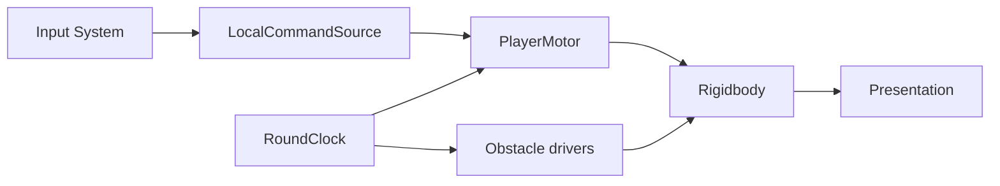

# Architecture

Unity **2021.3.25f1**. Built-in render pipeline. Physics fixed step **0.02** (50 Hz). Gravity **(0, −9.81, 0)**.

The runner is a dynamic rigidbody. Control is a state machine on top of it. Presentation watches that body. See [ADR-0001](decisions/ADR-0001-simulation-presentation-split.md) and [ADR-0002](decisions/ADR-0002-hybrid-rigidbody-motor.md).

## Runtime shape



One `FixedUpdate` tick:

1. `RoundClock.Advance()`.
2. Each command source builds a `PlayerCommand` for `clock.Tick`.
3. Each `PlayerMotor` simulates its command for `Time.fixedDeltaTime`.
4. Obstacle drivers sample `clock.Time` and set kinematic targets or forces.
5. PhysX steps.
6. Motors refresh grounded state from the new contacts.
7. `Update` runs presentation: camera, visual tilt, audio. No forces.

## Dependency rules

| Assembly | May reference | May not reference |
|---|---|---|
| `Tumble.Simulation` | Unity physics, own ScriptableObjects | Input System, UI, camera, audio, VFX, `Tumble.Presentation` |
| `Tumble.Presentation` | Simulation, Input System, Cinemachine 2.x | Writing motor state or rigidbody velocity |
| `Tumble.App` | Simulation, Presentation | Physics forces of its own |

`Tumble.App` loads scenes, spawns runners, and owns the clock. The Gym scene has an `App` bootstrap object so play mode from that scene works without a front-end.

Create the three `.asmdef` files with the first scripts, under `Assets/_Project/Scripts/`.

## Simulation states

`Upright` locks rigidbody rotation on X and Z and drives horizontal velocity toward the wish velocity. Y velocity is gravity plus jump.

`Diving` clears those locks, sets horizontal velocity to dive speed, and ignores most stick input until the dive timer ends.

`Stumbled` clears the locks and applies no wish velocity. Physics and contacts own the body.

`GettingUp` slerps toward upright, then returns to `Upright` and restores the locks.

`Grabbing` is specified later. The enum value exists so M1 code still compiles a full switch.

Grounded checks are downward capsule casts in the motor, short distance, mask `Ground` and `Obstacle`. A contact normal within `slopeLimit` of up counts as ground. Animation and the mesh renderer are not part of the check.

Self-motion writes velocity or uses `ForceMode.VelocityChange`. It does not use `AddForce` with mass-scaled acceleration. That keeps the profile numbers in meters per second when mass later changes for collisions.

## What stays local on purpose

These types are the multiplayer seam. Build them as plain C# with the signatures in [contracts.md](contracts.md). Do not put network attributes on them during the prototype.

- `PlayerCommand` crosses the network later as input.
- `PlayerSnapshot` crosses later as state.
- `RoundClock` becomes server time later. Callers change. The motor does not.
- Obstacle drivers already take a time sample, so a remote clock can drive them.
- `PlayerId` is already on the snapshot.

Authority, once multiplayer exists, is server-side physics with prediction for the local runner only. That choice and the rejected alternative (lockstep) are in [ADR-0007](decisions/ADR-0007-authority-model.md). The library is chosen in the M6 spike, not now.

## Project layout

Create this when M1 starts. Paths are under `Assets/`.

```
_Project/
  Art/
    Blockout/          # FBX from Blender
    Runner/
  Audio/
  Prefabs/
    Runner/
    Obstacles/
    Course/
  ScriptableObjects/
    Movement/          # MovementProfile
    Camera/            # CameraProfile
    Rounds/            # later RoundDefinition
  Scenes/
    Gym.unity
    Rounds/            # later
  Scripts/
    Simulation/        # Tumble.Simulation.asmdef
    Presentation/      # Tumble.Presentation.asmdef
    App/               # Tumble.App.asmdef
  Settings/            # Input Actions asset
```

`Assets/Scenes/SampleScene.unity` stays untouched until a person asks to remove it. The Gym is a new scene. Add the Gym to build settings when it exists. Do not add an empty bootstrap scene in M1.

## Packages

Already present and used: Test Framework, uGUI, TextMeshPro.

Add at the start of M1: **Input System** on the 1.7.x line Package Manager offers for 2021.3. Keep the old Input Manager active too (`Both`) so editor shortcuts survive. Gameplay code uses only the Input System.

Add when [SPEC-006](specs/SPEC-006-camera.md) starts: **Cinemachine 2.x**. Cinemachine 3 is a Unity 6 package and is out of scope on this editor.

Do not add Netcode for GameObjects, FishNet, Photon, or a transport during M0–M5.

## Editor constraints

APIs and package versions must support **2021.3.25f1**. Skip Unity 6-only members (`FindObjectsByType` overloads that do not exist here, UI Toolkit runtime patterns from Unity 6, Cinemachine 3 component names).

After script changes, refresh the editor and read the console before entering play mode. Leave the editor in edit mode when the task ends.

## Tests

Edit Mode tests cover pure rules: wish-direction from stick plus yaw, coyote and buffer expiry given a sequence of commands, qualify flag when a runner id overlaps a volume. They do not spin the full physics scene.

Feel is judged in the Gym with the checklist on the active spec, not with a physics assertion that fails when a number in the profile changes.

## Single-player now

One local `PlayerId`. The motor API still takes a command per id so a second Gym dummy can be driven by a scripted source later without a rewrite. That dummy is a grab target in M4, not an M1 requirement.
